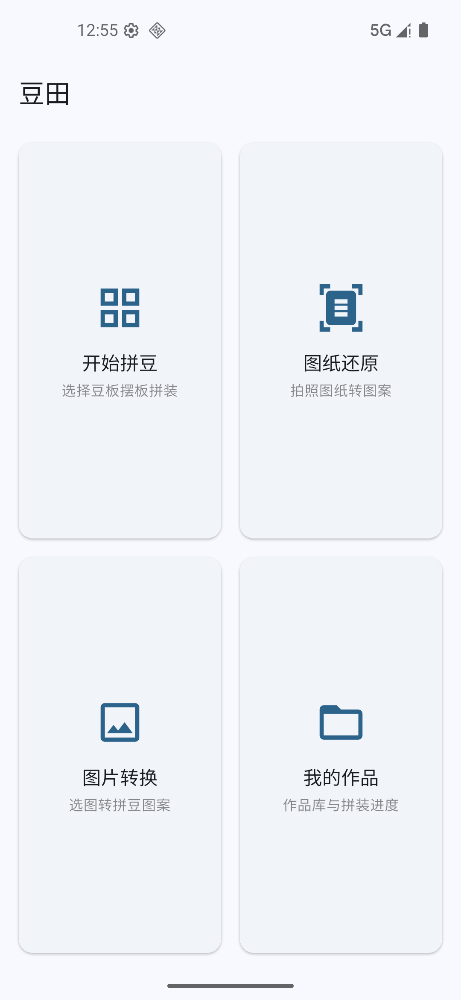
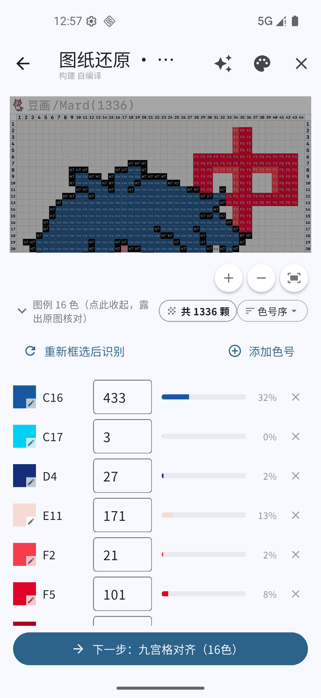
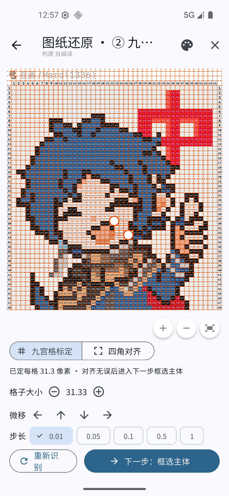
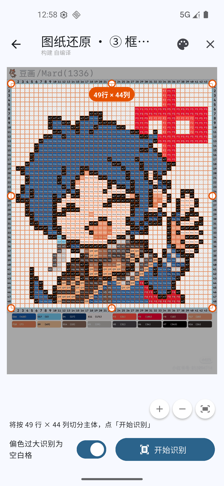
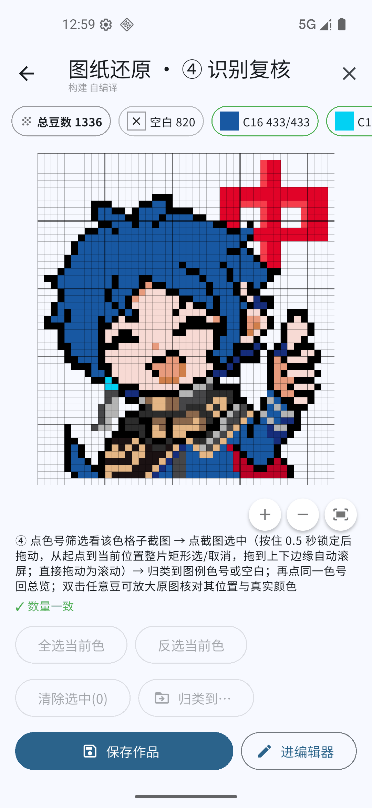
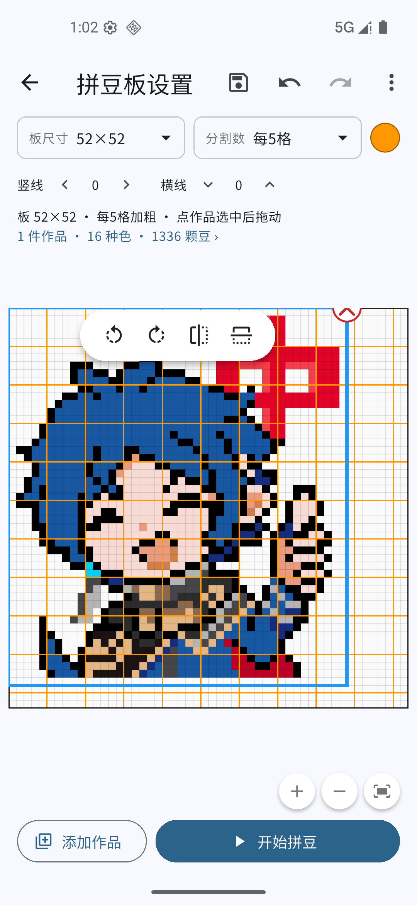
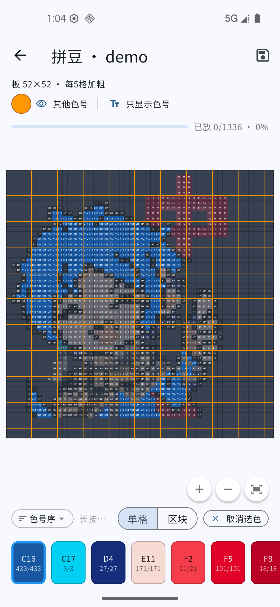

<div align="center">

# 豆田 · Bead Studio

**拍下拼豆图纸，还原成可以跟着拼的数字图纸**

[](https://flutter.dev)
[](#)
[](./LICENSE)

</div>

---

把一张拼豆图纸的照片变成手机上可对照拼装的图纸：自动框出图例、OCR 逐格读出印刷色号，
在「板设置」里摆板，再到「拼豆页」一颗颗跟着放——放过的自动打勾，退出 App 进度也不丢。

## 界面一览

| | |
|:---:|:---:|
|  |  |
| 主页 · 四大入口 | ① 框图例 · OCR 读图例色号与颗数 |
|  |  |
| ② 九宫格对齐 · 校正拍摄偏移 | ③ 框选主体 · 自动框出图案主体 |
|  |  |
| ④ 识别复核 · 逐色核对截图墙 | 板设置 · 作品摆位与板参数 |
|  | |
| 拼豆页 · 选中色号高亮、已放打勾 | |

## 核心功能

### 🧩 图纸还原（App 的主线）

拍下/保存的拼豆图纸照片，四步还原成可拼图案：

1. **① 框图例** — 自动检测图例区（游程带检测，兼容微信灰底图/带边框图），
   OCR 逐条读出「色号 + 颗数」，混淆字符（0/O、1/I/L…）自动纠错，
   漏读格二遍放大补读，读出即列出每种色的占比清单；
2. **② 九宫格对齐** — 格距自相关检测 + 九宫格叠加校准，微调有
   0.01~1 五档步长，拍歪了也能对齐；
3. **③ 框选主体** — 自动框出图案主体（剔除图例带、行列数字边），可手动拖框微调；
4. **④ 识别复核** — 逐格识别：**印刷色号是权威声明**——OCR 命中色号的格直接采用，
   读不到才回落 Lab 感知距离最近色，偏色过大判空白；复核页按色筛选截图墙，
   支持 全选/反选/长按拖动范围连选/归类换色。

### 🔗 链接导入

选图页直接粘贴小红书 / 抖音的分享文案，挑图进还原流程。

### 🖼️ 图片转换

任意图片（照片/线稿/头像）→ 拼豆图案：Lab 空间量化到色卡，
「色块 / 细节」两种风格，导出带网格线的 PNG 图纸。

### ✏️ 图案编辑器

画笔 / 橡皮 / 油漆桶 / 吸管 / 选区，50 步撤销重做，旋转/镜像/降噪/限色/全局换色，
支持 `.beadpattern` 图案文件导入导出。

### 📐 板设置

多块作品在豆板上摆位：拖动 / 旋转 / 翻转，允许悬挂出板（最多半幅），
出界豆格与重叠同样红标拦截；板尺寸、分割线间距、粗线颜色可调，撤销重做全程覆盖。

### 🫛 拼豆页

点色号 → 点格标记已放（绿勾），长按滑动批量圈选整色整块；
「全部作品 / 单件作品」两种进度口径，进度记忆在作品文件里——中途退出，
下次选同一块板直接续拼。已放豆灰化退后，亮着的都是还没拼的。

## 技术实现（给开发者）

- **Flutter**（Android 优先，Web 兼容）+ 自绘 **CustomPainter**（网格/选区/手势叠加层）；
- **google_mlkit_text_recognition** OCR + `image` 包像素处理；
  重活（解码/缩放/OCR 预处理）全部 `compute` isolate 出主线程，识别中 UI 不冻结、可随时终止；
- 识别哲学：**OCR 权威 + 色彩回退**——印刷色号命中即采用，未命中回落 Lab 最近色采样，
  近白无文本判空白格；
- 图例检测为自研游程带算法（v1→v9 调参记录见 [docs/vision_tuning_notes.md](docs/vision_tuning_notes.md)）。

### 代码结构

```
lib/
├── main.dart                     入口 + 主题 + 启动页
├── core/                         引擎层
│   ├── legend_detect.dart        图例区检测（游程带法 v9）
│   ├── legend_ocr.dart           图例 OCR（分带识别+二遍补读+配对纠错）
│   ├── grid_detector.dart        格距检测（中位数法/自相关法）
│   ├── subject_detect.dart       主体自动框选
│   ├── quantizer.dart            Lab 距离最近色量化
│   ├── palette_registry.dart     色卡注册与切换（MARD 等）
│   ├── draft_store.dart          作品/豆板持久化
│   ├── xhs_link.dart / douyin_link.dart …   链接导入解析
│   └── decode_image.dart         解码（Skia 优先 + 纯 Dart 回退）
└── features/                     界面层
    ├── home/                     主页四入口
    ├── restore/                  图纸还原（①②③④四步 + 链接导入面板）
    ├── editor/                   图案编辑器
    ├── board/                    板设置 + 豆板选择 + 拼豆页
    ├── import/                    图片转换
    └── works/ · stats/ · inventory/ · preview/   作品库 / 统计 / 用料清单 / 预览
```

## 获取与构建

已构建的 APK 见 [Releases](../../releases)（尚未发布时可按以下步骤自行构建）：

```bash
git clone https://gitee.com/TanakaMutsumi/bead_studio.git
cd bead_studio
flutter pub get
flutter build apk --release   # 全架构包，真机可直接安装
```

Windows 全新机器从零搭建环境的详细步骤见
[docs/build_setup.md](docs/build_setup.md)。

## 版本记录

面向用户的版本变化见 [CHANGELOG.md](CHANGELOG.md)（Keep a Changelog 格式）。

## 许可证

[MIT](./LICENSE) © 2026 田中带咸
